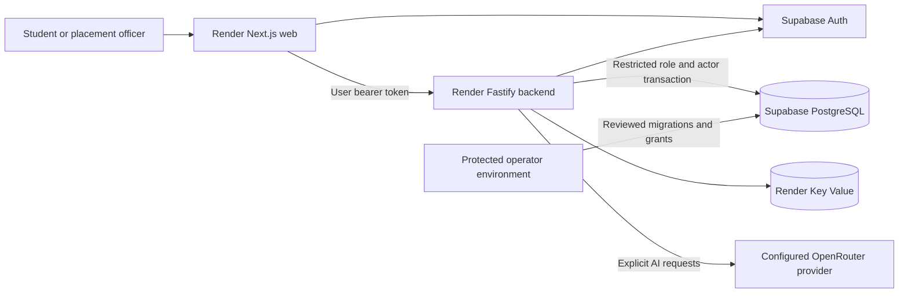

# Architecture and capacity

Target: 40,000–50,000 total accounts. This does not mean 50,000 simultaneous sessions. Keep a modular application with one transactional database until measurements justify independently scaling a module.

## Boundaries

Next handles UI, cookies and same-origin requests. Backend verifies JWTs independently and sets the actor inside a database transaction. Existing SQL security-definer RPCs enforce campus/officer grants. Student tables use row-level security and ownership checks. Startup rejects owner/superuser/BYPASSRLS roles. Official academics and self-profile are separate.

Private responses use no-store. Secrets/request bodies are not logged. Random request IDs connect responses with route/status/duration logs. Instances remain replaceable: no report, attachment text, answer or session depends on their local filesystem. Do not introduce shared caches of authenticated pages.

## Bounded work

Pool default: five connections per backend process, with connection/statement timeouts. Budget **instances × pool maximum + operators + other applications** below provider limits with headroom. Actor settings are transaction-local; there are no named prepared statements or persistent session-variable dependencies. Rehearse the selected Supabase pooler mode.

Ingress IP limits precede remote verification; post-auth limits use verified identity, so a campus/Next server does not share one user allowance. Production requires Redis and fails closed if limits are unavailable. AI has persisted user limits, per-process concurrency and provider deadlines. Transactions are released during external calls. Document extraction uses bounded workers and size/archive/page/time limits. Only extracted text/hashes are retained, without raw PDF or media recordings.

Opportunities paginate 24; history/library/operator tools expose the latest 100. Conversations cap at 200 messages, with latest 100 visible and latest 20 used as model history. Extend pagination as usage warrants. Reports/text accumulate: agree a retention policy and scheduled operator maintenance before rollout.

## Evidence and release sizing

On 15 October 2026, isolated PGlite loaded 50,000 students/academics and exercised restricted-role access. One sequential run took approximately 47 ms for own-record, 1,328 ms for directory and 863 ms for overview. This establishes local correctness at that data size, not production concurrency or throughput. Tests use --no-wasm-tier-up for predictable memory.

Before release, test actual Render plans, network region, PostgreSQL/pooler and JWTs with representative staging records. Set p95 latency, error, active concurrency, write-rate and AI cost/latency targets. Include synchronized exam starts, autosave, expiry, officer reports, Redis/provider failures, rolling deploys and DB saturation. Observe CPU/memory, event-loop delay, pool waits, SQL and provider quotas. Scale only within the connection budget.

Migrations never auto-run at startup. Use additive changes, backend-before-web deployment and compatible rollback releases. Rehearse provider backup restoration on staging.

Future ERP modules should share common identity/campus entities and own domain schemas/modules through explicit APIs. Keep invariants transactional. Add a durable queue/outbox when imports, long AI work or notifications need asynchronous delivery. Current AI is bounded synchronous work, not a durable job system.

References: [Render health](https://render.com/docs/health-checks), [Next self-hosting](https://nextjs.org/docs/app/guides/self-hosting), [Supabase connections](https://supabase.com/docs/guides/database/connection-management), [RLS](https://supabase.com/docs/guides/database/postgres/row-level-security), [JWTs](https://supabase.com/docs/guides/auth/jwts).
